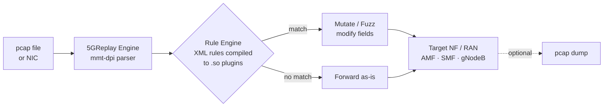

[](LICENSE)
[](https://github.com/Montimage/5GReplay/releases)


# Replay, mutate, and inject 5G traffic against live network functions

5GReplay captures or reads 5G pcap traffic, applies XML-defined mutation rules at the packet level, and forwards the modified packets to a target NF (AMF, SMF, UPF) or RAN (gNodeB) over SCTP/UDP — online or offline, control plane or data plane.

[**Get Started →**](#quick-start) · [**Full docs →**](https://5greplay.org)

---

## How It Works



Rules are compiled from XML to shared libraries (`.so`) at runtime. Each rule defines a packet pattern and a reactive action: forward, modify, fuzz, drop, or execute arbitrary C.

---

## Features

| Capability | Details |
|---|---|
| Offline + online modes | Read from `.pcap` or capture live from a NIC |
| XML rule engine | Declarative rules compiled to native `.so` plugins |
| Packet mutation | Rewrite any protocol field (NGAP, NAS-5G, SCTP, IP, Ethernet, GTP) |
| Fuzzing | `#fuzz()` built-in randomizes numeric fields; override `random()` with custom C |
| Traffic amplification | `-Xforward.nb-copies=N` replays each packet N times |
| User-parameterized rules | Pass runtime values into rules via `-U key=value` |
| pcap output | Dump forwarded/mutated packets to file alongside live injection |
| Multi-thread engine | Distribute rules across threads with `rules-mask` |

---

## Quick Start

**Option A — Docker (no build required):**

```bash
docker run --rm -it ghcr.io/montimage/5greplay
```

Replay a bundled pcap against a remote AMF:

```bash
docker run --rm -it ghcr.io/montimage/5greplay \
  replay -t pcap/sa.pcap \
  -Xforward.target-hosts=10.0.0.2 \
  -Xforward.target-ports=38412 \
  -Xforward.nb-copies=2000 \
  -Xforward.default=FORWARD
```

**Option B — Pre-built binary (Ubuntu):**

```bash
wget https://github.com/Montimage/5GReplay/releases/download/v1.0.0/5greplay-1.0.0_Linux_x86_64.tar.gz
tar -xzf 5greplay-1.0.0_Linux_x86_64.tar.gz
cd 5greplay-1.0.0
./5greplay -h
```

**Option C — Build from source:**

```bash
sudo apt install gcc make git libxml2-dev libpcap-dev libconfuse-dev libsctp-dev
wget https://github.com/Montimage/mmt-dpi/releases/download/v1.7.9/mmt-dpi_1.7.9_8694eaa_Linux_x86_64.deb
sudo dpkg -i mmt-dpi*.deb && sudo ldconfig
git clone https://github.com/montimage/5greplay && cd 5greplay
make && make sample-rules
```

---

## Usage Examples

**Replay pcap offline, forward all packets:**

```bash
sudo ./5greplay replay -t capture.pcap -Xforward.default=FORWARD
```

**Live capture from interface, apply rules:**

```bash
sudo ./5greplay replay -i eth0 -c mmt-5greplay.conf
```

**Compile an XML rule to a plugin:**

```bash
./5greplay compile rules/my-rule.so rules/my-rule.xml
```

**List all supported protocol attributes:**

```bash
./5greplay list
```

**Fuzz NGAP fields using a custom rule:**

```xml
<property property_id="7" type_property="FORWARD"
    description="Fuzz NGAP procedure code and UE IDs"
    if_satisfied="#fuzz(ngap.ran_ue_id, ngap.amf_ue_id, ngap.procedure_code)">
  <event description="Any NGAP packet"
         boolean_expression="(ngap.procedure_code != 0)"/>
</property>
```

```bash
./5greplay compile rules/fuzz-ngap.so rules/fuzz-ngap.xml
sudo ./5greplay replay -i n2-interface -c mmt-5greplay.conf
```

**Parameterize a rule at runtime (e.g., set target MAC):**

```bash
sudo ./5greplay replay -t capture.pcap -U eth-dst=aa:bb:cc:dd:ee:ff -Xforward.default=FORWARD
```

---

## Bundled Rules

| Rule | Protocol | Action |
|---|---|---|
| `4.nas-smc-replay-attack.xml` | NAS-5G | Replay NAS Security Mode Complete |
| `6.modify-ran-ue-id.xml` | NGAP | Rewrite RAN UE ID |
| `7.fuzz-ngap.xml` | NGAP | Fuzz procedure code, UE IDs |
| `9.malformed-ngap.rand-procedure-code.xml` | NGAP | Inject malformed procedure codes |
| `11.modify-sctp-params.xml` | SCTP | Modify SCTP parameters |
| `101.delay-ethernet-microsecond.xml` | Ethernet | Delay packets by N µs |
| `111.ddos-ip.xml` | IP | Randomize source IPs (DDoS emulation) |

All rules in [`rules/`](rules/).

---

## Commands

| Command | Purpose |
|---|---|
| `replay` | Replay pcap or live traffic with rules applied |
| `compile` | Compile XML rule → `.so` plugin |
| `info` | Print rule metadata from a `.so` file |
| `list` | List all supported protocols and attributes |
| `extract` | Extract field values from a pcap or NIC |

---

<details>
<summary>Configuration file reference</summary>

Default config: `mmt-5greplay.conf`

Key sections:

- `input` — mode (`ONLINE`/`OFFLINE`), source interface or pcap path, snap-len
- `forward` — target host/port, nb-copies, default action (`FORWARD`/`DROP`)
- `engine` — thread count, rule exclusion, rules-mask for thread affinity
- `mempool` — memory pool tuning (max-bytes, max-elements)
- `output` — optional alert reporting to file

Override any key inline: `-X engine.thread-nb=4 -X forward.nb-copies=500`

</details>

<details>
<summary>XML rule structure</summary>

A rule file contains one or more `<property>` elements:

```xml
<property property_id="N" type_property="FORWARD|ATTACK"
    description="..."
    if_satisfied="em_my_callback">

  <event event_id="1"
         boolean_expression="(proto.attribute == value)"/>
  <event event_id="2"
         boolean_expression="(proto.attribute == value.1)"/>
</property>
```

- `type_property="FORWARD"` — packets matching the rule are forwarded (possibly mutated)
- `type_property="ATTACK"` — rule match triggers an alert
- `if_satisfied` — name of a C callback defined in `<embedded_functions>`
- `#fuzz(attr1, attr2)` — built-in: randomizes listed numeric attributes before forwarding
- `get_input("key")` — reads a `-U key=value` parameter passed at startup

Embedded C is compiled directly into the `.so` plugin. Standard C library and `mmt_lib.h` are pre-included.

</details>

<details>
<summary>Building and development</summary>

```bash
make                # build 5greplay binary
make sample-rules   # compile all rules in rules/ to .so
make DEBUG=1        # build with gdb symbols
make DEBUG=1 VALGRIND=1  # build for Valgrind DRD/Helgrind
make clean
```

Dependency: [mmt-dpi](https://github.com/Montimage/mmt-dpi) — the DPI library that parses 5G protocol stacks (NGAP, NAS-5G, GTP, SCTP, HTTP/2, ...).

</details>
---

Apache 2.0 Licensed · [5greplay.org](https://5greplay.org) · [Issues](https://github.com/Montimage/5GReplay/issues)
